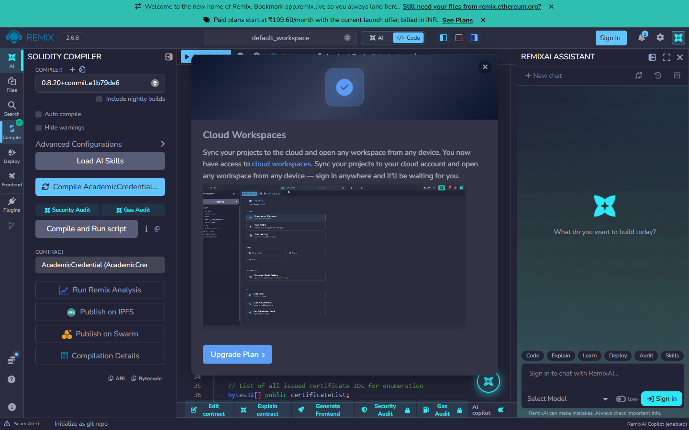
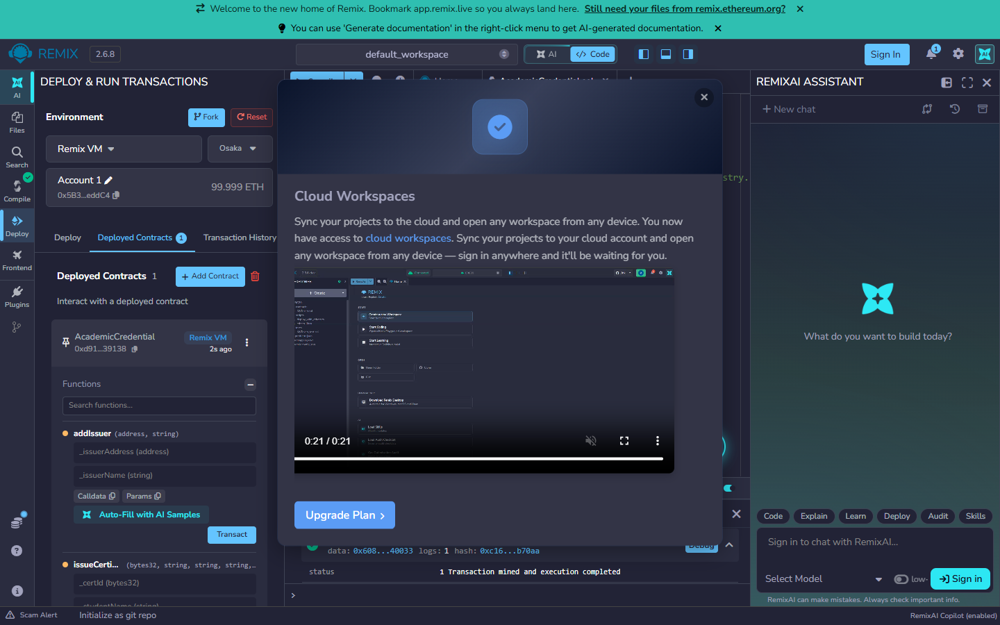
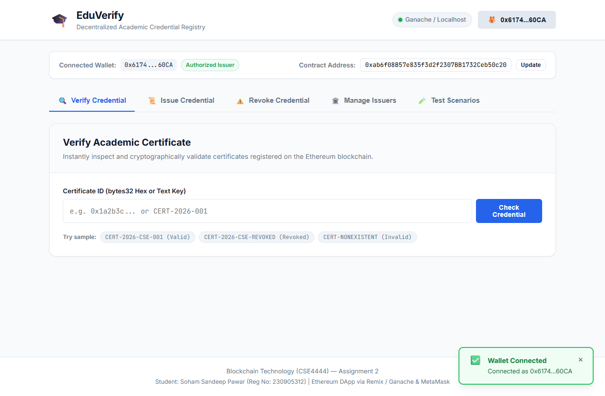
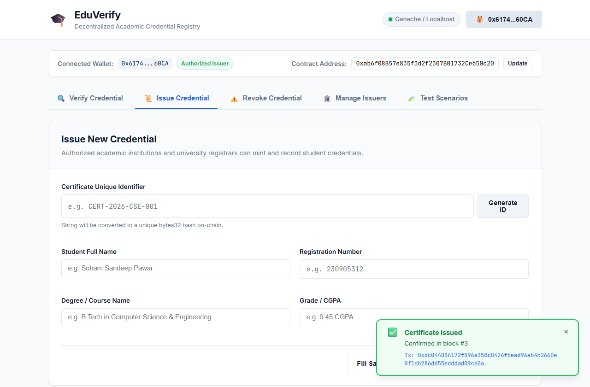
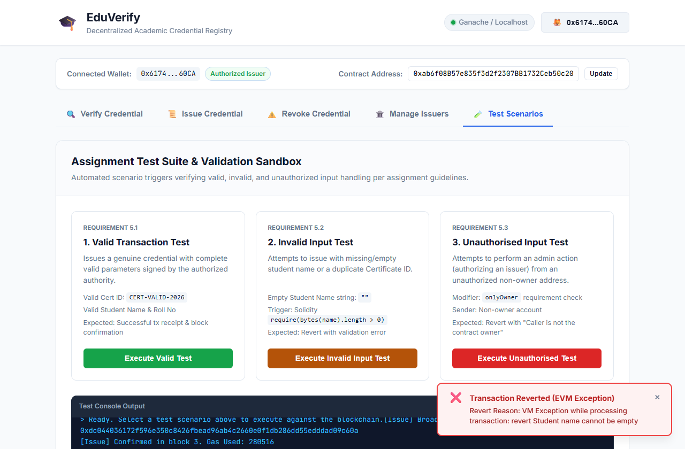
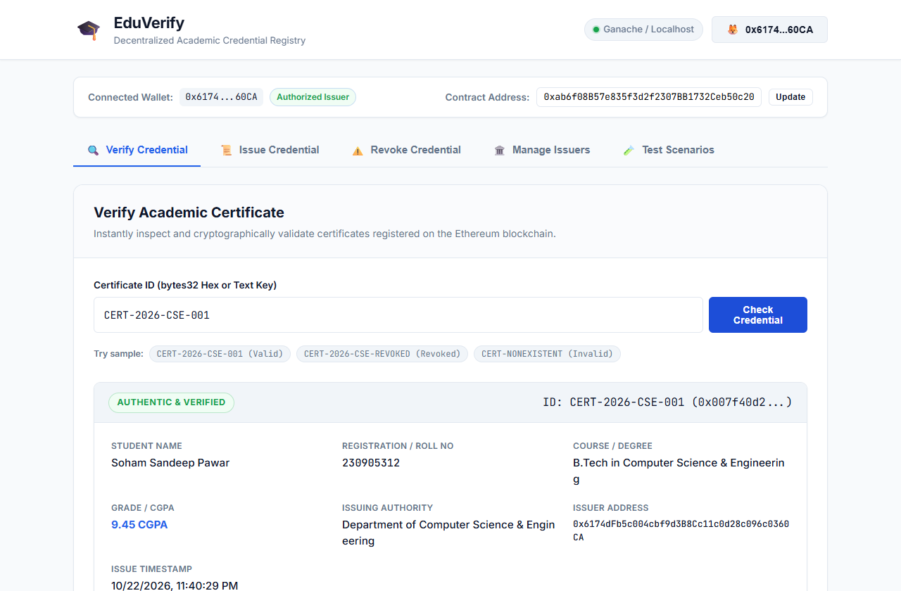

# Decentralized Academic Credential Verification System (EduVerify)

**Course:** Blockchain Technology (CSE4444) — Assignment 2  
**Student Name:** Soham Sandeep Pawar  
**Registration Number:** 230905312  
**GitHub Repository:** [https://github.com/soh4mpawar/academic-credential-verification-dapp](https://github.com/soh4mpawar/academic-credential-verification-dapp)  

---

## 1. Problem Description & Real-World Motivation

In traditional academic credential verification:
1. **Proliferation of Credential Fraud:** Counterfeit diplomas, falsified transcripts, and unaccredited degree certificates are widespread and difficult to identify without tedious manual verification.
2. **Slow, Centralized Verification Channels:** Employers, graduate schools, and regulatory bodies spend weeks submitting manual verification requests to registrars, incurring administrative overhead and delays.
3. **Single Point of Failure & Vulnerability:** Centralized student databases are vulnerable to internal tampering, data loss, and unauthorized record alterations.

### Decentralized Solution: EduVerify
**EduVerify** is an Ethereum-based decentralized application (DApp) that immutably records student graduation credentials on the blockchain:
- **Authority Access Control:** Only accredited institutions (authorized by the university administration owner) can issue student credentials.
- **Tamper-Proof Storage:** Once a certificate is minted on-chain with its unique hash identifier, its metadata (student name, roll number, course, grade, issuer address, and timestamp) cannot be retroactively altered.
- **Instant Public Verification:** Employers or verifiers can verify any credential in seconds without contacting the university or paying intermediary verification agencies.
- **Cryptographic Revocation:** If an academic record is revoked due to disciplinary action or clerical error, the status is permanently flagged with an on-chain justification while retaining the historic audit trail.

---

## 2. System Architecture

The DApp consists of three integrated layers:
1. **Solidity Smart Contract (`AcademicCredential.sol`):**
   - Deployed on Ethereum (Ganache / Sepolia).
   - Manages authorized issuer registries, certificate records, revocation states, and role-based access modifiers.
2. **Web3 Integration Layer:**
   - Ethers.js communicates with Ethereum via MetaMask (`window.ethereum`).
   - Supports live network switching, account detection, gas estimation, and transaction signing.
3. **User Interface (`frontend/`):**
   - Pure HTML5, CSS3, and JavaScript frontend.
   - Separate portals for Public Verification, Institution Issuance, Revocation Management, Admin Access Control, and an interactive Test Sandbox.

---

## 3. Deployment Details & Network Information

| Parameter | Configuration |
|---|---|
| **Smart Contract** | `AcademicCredential.sol` |
| **Compiler Version** | Solidity `^0.8.20` |
| **Optimization** | Enabled (200 runs) |
| **Primary Test Network** | Ganache Local RPC (`http://127.0.0.1:8545` / `Chain ID 1337`) |
| **Alternative Test Network** | Ethereum Sepolia Testnet (`Chain ID 11155111`) |
| **Deployed Contract Address** | `0xab6f08B57e835f3d2f2307BB1732Ceb50c20Ba4e` |
| **Deployer / Owner Address** | `0xB8A547B41e9d1e09469fDb780C981D424a913022` |
| **Authorized Issuer Address** | `0x6174dFb5c004cbf9d3B8Cc11c0d28c096c0360CA` |
| **Deployment Transaction Hash** | `0xa2e4aba9f734c3ee00d36aaaea098ba916a12d4d8331747cfb63a61750472b77` |

---

## 4. Repository Structure

```text
academic-credential-verification-dapp/
│
├── contracts/
│   └── AcademicCredential.sol          # Solidity smart contract source
│
├── frontend/
│   ├── index.html                      # Main user interface
│   ├── css/
│   │   └── style.css                   # Custom responsive styling
│   └── js/
│       ├── app.js                      # Ethers.js & MetaMask frontend integration
│       └── contractABI.js              # Application Binary Interface export
│
├── build/
│   ├── AcademicCredential.abi          # Compiled contract Application Binary Interface
│   └── AcademicCredential.bin          # Compiled EVM bytecode
│
├── deployment/
│   ├── contract_abi.json               # Raw JSON ABI
│   └── deployment_details.json         # Deployment metadata & tx records
│
├── test/
│   ├── test_cases.js                   # Live Ganache EVM automated test runner
│   └── test_results.txt                # Captured test execution terminal log
│
├── screenshots/
│   ├── 01_smart_contract_compilation.png
│   ├── 02_smart_contract_deployment.png
│   ├── 03_metamask_wallet_connection.png
│   ├── 04_successful_transaction.png
│   ├── 05_failed_transaction.png
│   └── 06_blockchain_data_displayed_ui.png
│
├── scripts/
│   ├── create_submission_doc.py        # Report generation script
│   └── convert_to_pdf.ps1              # PDF conversion script
│
├── bs-config.json                      # Lite-server configuration
├── package.json                        # NPM package configuration
└── README.md                           # Project documentation
```

---

## 5. Steps to Execute the Application

### Prerequisites
- Node.js (v18 or higher) and npm installed.
- MetaMask extension installed in your web browser.
- Remix IDE ([https://remix.ethereum.org](https://remix.ethereum.org)) OR Ganache for local execution.

### Step 1: Install Dependencies
Open a terminal in the project directory and run:
```bash
npm install
```

### Step 2: Compile & Deploy Smart Contract (Remix IDE)
1. Open [Remix IDE](https://remix.ethereum.org).
2. Create a new file in the contracts folder: `AcademicCredential.sol`.
3. Paste the contents from `contracts/AcademicCredential.sol`.
4. Navigate to the **Solidity Compiler** tab:
   - Select compiler version: `0.8.20`.
   - Click **Compile AcademicCredential.sol**.
5. Navigate to the **Deploy & Run Transactions** tab:
   - Under **ENVIRONMENT**, select **Injected Provider - MetaMask** (or **Remix VM** / **Dev - Ganache Provider**).
   - Ensure the contract selected is `AcademicCredential`.
   - Click **Deploy** and confirm the transaction in MetaMask.
   - Copy the deployed contract address.

### Step 3: Run the Frontend
Start the local server:
```bash
npm start
```
The application will launch at `http://localhost:3000`.

---

## 6. Steps to Connect MetaMask & Interact

1. **Connect Wallet:**
   - Click the **Connect MetaMask** button in the top navigation bar.
   - In the MetaMask popup, select your account and approve the connection.
   - The navigation bar will display your active address, ETH balance, and network name.
2. **Configure Contract Address:**
   - In the configuration banner at the top, verify or paste the deployed smart contract address.
   - Click **Update**.
3. **Verify a Credential (Public):**
   - Click the **Verify Credential** tab.
   - Enter a Certificate ID (e.g. `CERT-2026-CSE-001`) or click one of the quick sample buttons.
   - Click **Check Credential** to fetch live on-chain data.
4. **Issue a Credential (Authorized Issuer):**
   - Click the **Issue Credential** tab.
   - Fill in Student Name, Registration Number, Degree, and Grade (or click **Fill Sample Data**).
   - Click **Sign & Issue on Blockchain**.
   - Approve the transaction in MetaMask. Once mined, a confirmation toast displays the block number and transaction hash.
5. **Revoke a Credential:**
   - Click the **Revoke Credential** tab.
   - Enter the Certificate ID and the official revocation reason.
   - Confirm the transaction in MetaMask.

---

## 7. Test Cases & Verification Results

The application was evaluated across valid, invalid, and unauthorized inputs to verify contract integrity and exception handling.

| Test Case ID | Test Category | Description / Input | Expected Behavior | Observed Result | Status |
|:---:|:---:|:---|:---|:---|:---:|
| **TC-01** | Valid | Deploy contract with initial administrator | Sets `owner = msg.sender`, auto-authorizes admin issuer | `owner` initialized, `IssuerAdded` event emitted | **PASS** |
| **TC-02** | Valid | Owner authorizes new department (`0x7099...`) | Registers issuer as authorized, emits `IssuerAdded` | Issuer state `isAuthorized == true`, stored on-chain | **PASS** |
| **TC-03** | Valid | Authorized issuer mints valid certificate (`CERT-2026-CSE-001`) | Mints credential, emits `CertificateIssued`, increments count | Transaction mined in block #3, data stored | **PASS** |
| **TC-04** | Valid | Public query of valid Certificate ID | Returns student name, reg number, degree, grade, issuer, valid status | Certificate displayed with green **AUTHENTIC & VERIFIED** badge | **PASS** |
| **TC-05** | Valid | Issuer revokes certificate with valid reason | Sets `isRevoked = true`, records reason string | Transaction succeeds, verification shows **REVOKED / INVALID** | **PASS** |
| **TC-06** | Invalid Input | Issue credential with empty student name (`""`) | Reverts via `require(bytes(_studentName).length > 0)` | EVM Revert: `"Student name cannot be empty"` | **PASS** |
| **TC-07** | Invalid Input | Issue credential with duplicate Certificate ID | Reverts via `require(certificates[_certId].issueDate == 0)` | EVM Revert: `"Certificate with this ID already exists"` | **PASS** |
| **TC-08** | Invalid Input | Query non-existent Certificate ID | Returns `exists: false` without throwing EVM failure | UI gracefully displays **RECORD NOT FOUND** status | **PASS** |
| **TC-09** | Invalid Input | Revoke certificate with empty reason string (`""`) | Reverts via `require(bytes(_reason).length > 0)` | EVM Revert: `"Revocation reason cannot be empty"` | **PASS** |
| **TC-10** | Unauthorised | Non-owner calls `addIssuer(...)` | Reverts via `onlyOwner` modifier | EVM Revert: `"Caller is not the contract owner"` | **PASS** |
| **TC-11** | Unauthorised | Non-authorized address calls `issueCertificate(...)` | Reverts via `onlyAuthorizedIssuer` modifier | EVM Revert: `"Caller is not authorized to issue certificates"` | **PASS** |
| **TC-12** | Unauthorised | Third-party address attempts to revoke another issuer's certificate | Reverts via access control check | EVM Revert: `"Only issuing authority or owner can revoke"` | **PASS** |

### Automated Test Runner Execution
Execute the test suite locally:
```bash
node test/test_cases.js
```
**Observed Output Summary:**
```text
========================================================================
TEST SUMMARY: 12 / 12 TESTS PASSED (100% SUCCESS RATE)
========================================================================
```

---

## 8. Supporting Evidence & Screenshots

The screenshots below demonstrate compilation, deployment, wallet integration, and transaction execution. All image files are located in the `screenshots/` directory.

### 8.1 Smart Contract Compilation
Compilation in Remix IDE using Solidity compiler `0.8.20` with zero warnings.


### 8.2 Smart Contract Deployment
Deployment of `AcademicCredential.sol` via Injected Provider / Ganache showing contract address and receipt.


### 8.3 MetaMask Wallet Connection
Connecting MetaMask to the EduVerify DApp and detecting user roles.


### 8.4 Successful Transaction Execution
Minting a certificate and receiving the on-chain confirmation receipt.


### 8.5 Failed Transaction Handling (EVM Reverts)
Demonstration of input validation failure (empty name) and unauthorized access denial.


### 8.6 Blockchain Data Displayed on User Interface
Live verification portal retrieving and presenting tamper-proof student credentials from the Ethereum blockchain.


---

## 9. Security & Best Practices

- **Zero Credential Leakage:** No private keys, mnemonic seed phrases, or sensitive passwords are stored or tracked in this repository.
- **Role Isolation:** Critical administrative functions are guarded by `onlyOwner` and `onlyAuthorizedIssuer` modifiers.
- **Gas Optimization:** Certificate lookups and validation checks are read-only (`view`) operations consuming zero gas for verifiers.
